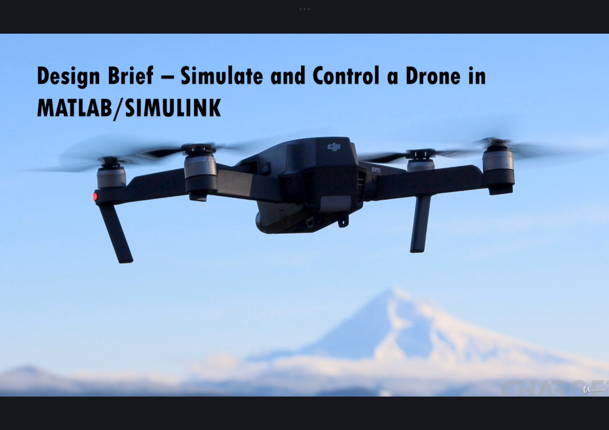
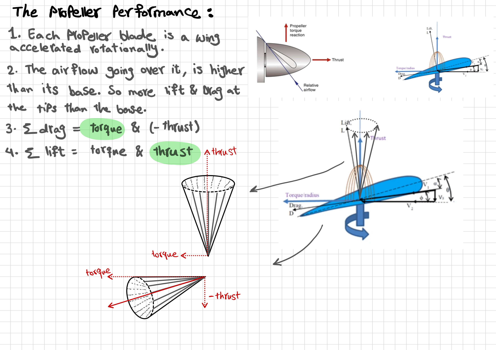
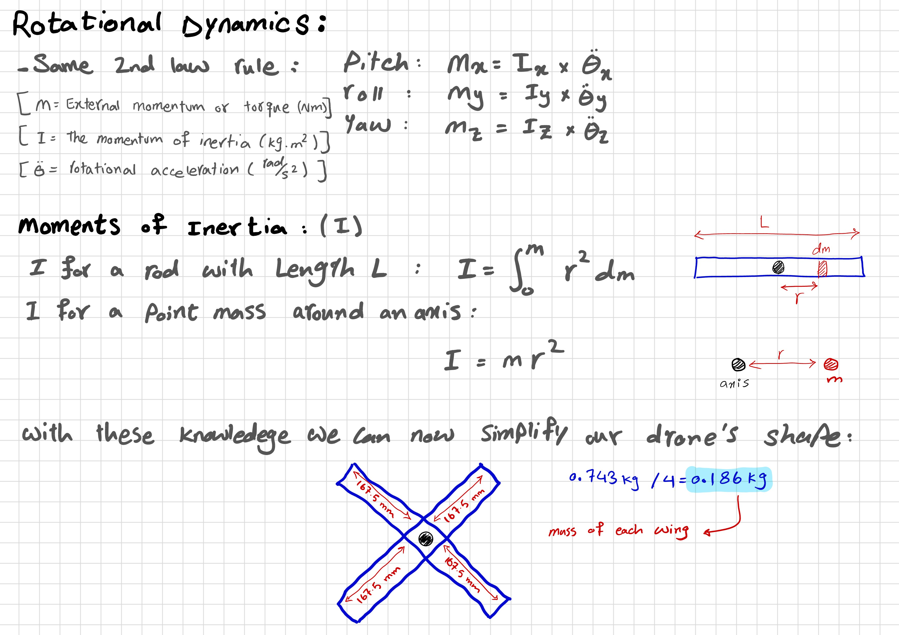
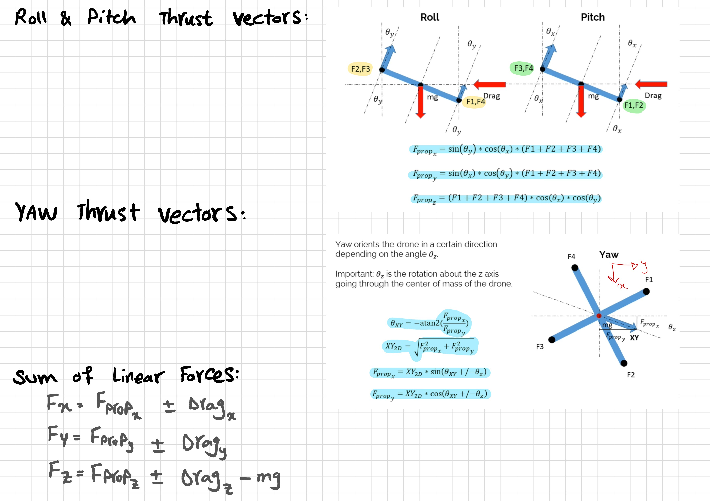

#  DJI Mavic Pro Simulation in MATLAB/Simulink

This project simulates the dynamics, actuation, and control of a DJI Mavic Pro drone using MATLAB and Simulink. The model includes battery behavior, BLDC motor dynamics, propeller thrust, aerodynamic drag, and a closed-loop PID controller.

  

---

##  Model Overview

- **Drone:** DJI Mavic Pro
- **Weight:** 0.743 kg
- **Motor KV:** 1400 RPM/V
- **Battery:** 11.4V, 77A max (3s LiPo)
- **Propeller Size:** 8x4"
- **Structure:** X-frame quadcopter (335 mm diagonal)
- **Simulation Includes:**
  - Motor–Prop–Battery coupling
  - Blade element theory for thrust
  - Torque loading & current consumption
  - Linear & rotational dynamics
  - External disturbances (wind, drag)
  - Full control loop (PID)

---

##  Mathematical Modeling

Key equations used:

- **Thrust:**  
  `T = C_T * ρ * n² * D⁴`

- **Motor Current from Torque:**  
  `I = Torque × Kᵥ`

- **Drag Force:**  
  `F_drag = 0.5 * ρ * A * V² * C_d`

- **Rotational Dynamics:**  
  `M = I × θ̈`

More derivations and visuals available in [`Docs/images/`](Docs/images).

---

##  System Block Diagram

  

---

##  File Structure

| Folder           | Description                                 |
|------------------|---------------------------------------------|
| `Simulink_Model` | Main simulation `.slx` and model blocks     |
| `MATLAB_Code`    | Parameter extraction, plots, data fits      |
| `Docs`           | All handwritten analysis and visual notes   |

---

##  Features

- Full 3D drone model with XYZ and rotational DOF
- Aerodynamic and electrical interaction modeling
- Custom battery and motor behavior estimation
- Modular and easy to modify for different drone specs
- Clean structure and well-documented equations

---

##  Analysis Preview

| Propeller Analysis | Rotational Dynamics | System Forces |
|--------------------|---------------------|----------------|
|  |  |  |

---

##  Future Work

- Build hardware prototype (ESP32/Pixhawk)

---

##  License

MIT License. See [LICENSE](LICENSE) for details.

